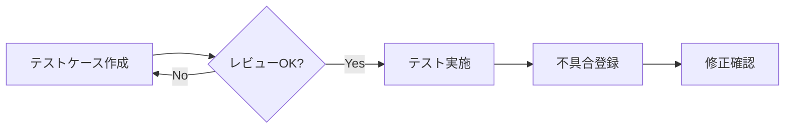
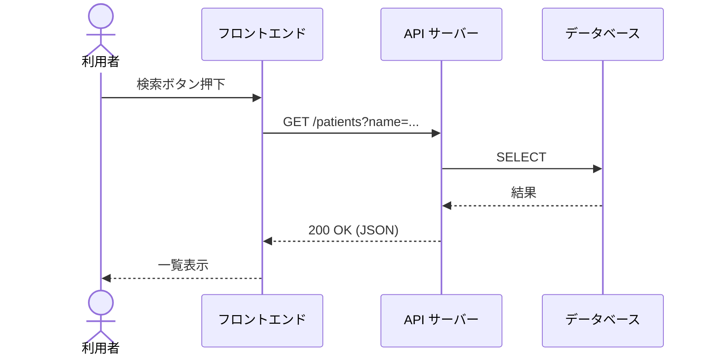
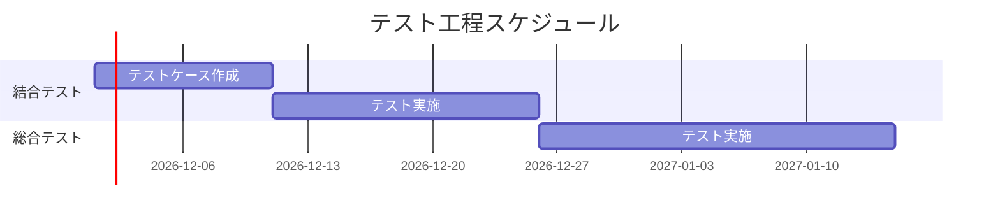
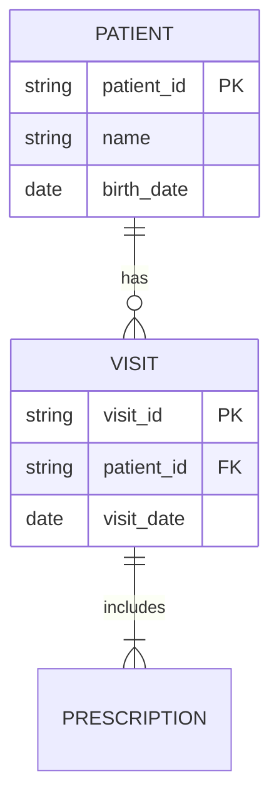

# 🌳 上級編：GitHub で表現力を最大化する

GitHub Flavored Markdown（GFM）や GitHub 独自の拡張機能を使った、一歩進んだ書き方です。

## 目次

- [1. アラート（注意書きボックス）](#1-アラート注意書きボックス)
- [2. Mermaid で図を描く](#2-mermaid-で図を描く)
- [3. 数式（LaTeX）](#3-数式latex)
- [4. HTML タグの活用](#4-html-タグの活用)
- [5. GitHub 独自の自動リンク](#5-github-独自の自動リンク)
- [6. コードのパーマリンク埋め込み](#6-コードのパーマリンク埋め込み)
- [7. 絵文字](#7-絵文字)
- [8. フロントマター（YAML）](#8-フロントマターyaml)
- [9. ライトモード / ダークモード別の画像](#9-ライトモード--ダークモード別の画像)
- [10. コメントアウト](#10-コメントアウト)
- [11. 品質を保つ仕組み（Lint と CI）](#11-品質を保つ仕組みlint-と-ci)

---

## 1. アラート（注意書きボックス）

GitHub では 5 種類のアラートが使えます。

```markdown
> [!NOTE]
> 補足情報。読み飛ばしても問題ない内容。

> [!TIP]
> 知っておくと便利なコツ。

> [!IMPORTANT]
> 目的を達成するために必要な重要情報。

> [!WARNING]
> すぐに注意が必要な内容。

> [!CAUTION]
> 実行するとリスクがある操作。
```

表示：

> [!NOTE]
> 補足情報。読み飛ばしても問題ない内容。

> [!TIP]
> 知っておくと便利なコツ。

> [!IMPORTANT]
> 目的を達成するために必要な重要情報。

> [!WARNING]
> すぐに注意が必要な内容。

> [!CAUTION]
> 実行するとリスクがある操作。

> [!TIP]
> アラートは使いすぎると効果が薄れます。1 つのセクションに 1〜2 個までを目安にしましょう。

---

## 2. Mermaid で図を描く

コードブロックの言語を `mermaid` にすると、テキストから図が生成されます。
**図をコードで管理できる** ので、差分レビューができるのが大きな利点です。

### フローチャート

````markdown

````


### シーケンス図



### ガントチャート



### ER 図



その他、クラス図（`classDiagram`）、状態遷移図（`stateDiagram-v2`）、円グラフ（`pie`）なども描けます。
書き方は [Mermaid 公式ドキュメント](https://mermaid.js.org/intro/) を参照してください。

---

## 3. 数式（LaTeX）

### インライン数式

`$` で囲みます。

```markdown
バグ密度は $\frac{\text{不具合件数}}{\text{規模(KLOC)}}$ で求めます。
```

表示：バグ密度は $\frac{\text{不具合件数}}{\text{規模(KLOC)}}$ で求めます。

### ブロック数式

`$$` で囲むと独立した行に表示されます。

```markdown
$$
\text{テスト密度} = \frac{\text{テストケース数}}{\text{開発規模(KLOC)}}
$$
```

表示：

$$
\text{テスト密度} = \frac{\text{テストケース数}}{\text{開発規模(KLOC)}}
$$

---

## 4. HTML タグの活用

Markdown だけでは難しいレイアウトは HTML で補えます。

### 画像のサイズ指定・中央寄せ

```html
<p align="center">
  
</p>
```

### キーボード表記

```markdown
<kbd>Ctrl</kbd> + <kbd>Shift</kbd> + <kbd>V</kbd> でプレビュー
```

表示：<kbd>Ctrl</kbd> + <kbd>Shift</kbd> + <kbd>V</kbd> でプレビュー

### 上付き・下付き文字

```markdown
H<sub>2</sub>O、x<sup>2</sup>
```

表示：H<sub>2</sub>O、x<sup>2</sup>

> [!WARNING]
> GitHub ではセキュリティのため、`<script>`・`<style>`・`style` 属性などは削除されます。
> 色付き文字や独自 CSS は使えないと考えてください。

---

## 5. GitHub 独自の自動リンク

Issue・PR・コメントの中で、以下は自動的にリンクになります。

| 書き方 | リンク先 |
| :--- | :--- |
| `#123` | 同じリポジトリの Issue / PR #123 |
| `owner/repo#123` | 別リポジトリの Issue / PR |
| `@username` | ユーザー（**通知が飛ぶので注意**） |
| `@org/team-name` | チーム |
| コミットの SHA（7 桁以上） | そのコミット |

### PR から Issue を自動でクローズする

PR の説明文に次のキーワードを書くと、マージ時に Issue が自動でクローズされます。

```markdown
Closes #12
Fixes #34
Resolves #56
```

---

## 6. コードのパーマリンク埋め込み

GitHub 上でファイルの行番号をクリック → `…` → **Copy permalink** で取得した URL を
Issue や PR に貼ると、コードの該当箇所がプレビュー表示されます。

```text
https://github.com/OWNER/REPO/blob/<commit-sha>/src/Main.java#L10-L20
```

> [!TIP]
> ブランチ名（`main`）ではなく **コミット SHA** を含む URL を使うと、後でコードが変わってもリンク先がずれません。

---

## 7. 絵文字

`:名前:` で絵文字が入ります。

| 書き方 | 表示 | 用途例 |
| :--- | :---: | :--- |
| `:white_check_mark:` | :white_check_mark: | 完了 |
| `:warning:` | :warning: | 注意 |
| `:x:` | :x: | NG |
| `:memo:` | :memo: | メモ |
| `:rocket:` | :rocket: | リリース |
| `:bug:` | :bug: | バグ |

一覧は [Emoji Cheat Sheet](https://github.com/ikatyang/emoji-cheat-sheet) を参照してください。

---

## 8. フロントマター（YAML）

ファイル先頭に `---` で囲んだ YAML を書くと、メタ情報として扱われます。
GitHub では表として表示され、Zenn・Jekyll・Hugo などの静的サイトジェネレーターでは記事設定として使われます。

```yaml
---
title: "Markdown 上級テクニック"
emoji: "📝"
type: "tech"
topics: ["markdown", "github"]
published: true
---
```

---

## 9. ライトモード / ダークモード別の画像

`<picture>` タグを使うと、閲覧者のテーマに合わせて画像を切り替えられます。

```html
<picture>
  <source media="(prefers-color-scheme: dark)" srcset="../assets/images/logo-dark.png">
  <source media="(prefers-color-scheme: light)" srcset="../assets/images/logo-light.png">
  
</picture>
```

---

## 10. コメントアウト

HTML コメントは表示されません。執筆中のメモや TODO に使えます。

```markdown
<!-- TODO: 図を差し替える -->
```

> [!CAUTION]
> コメントは画面には出ませんが、**ソースを見れば誰でも読めます**。パスワードや社外秘情報は書かないでください。

---

## 11. 品質を保つ仕組み（Lint と CI）

チームで Markdown を書くなら、ルールを機械的にチェックする仕組みを入れましょう。
このリポジトリにはすでに設定済みです。

| ファイル | 役割 |
| :--- | :--- |
| [`.markdownlint.json`](../.markdownlint.json) | 文法チェックのルール |
| [`.editorconfig`](../.editorconfig) | 文字コード・改行コード・インデントの統一 |
| [`.github/workflows/markdownlint.yml`](../.github/workflows/markdownlint.yml) | push / PR 時に自動でチェック |
| [`.github/pull_request_template.md`](../.github/pull_request_template.md) | PR 説明文の雛形 |
| [`.github/ISSUE_TEMPLATE/`](../.github/ISSUE_TEMPLATE/) | Issue の雛形 |

手元で実行する場合：

```bash
# チェックのみ
npx markdownlint-cli2 "**/*.md"

# 自動修正できるものは修正
npx markdownlint-cli2 --fix "**/*.md"
```

---

⬅️ [中級編](02-intermediate.md) ｜ ➡️ [早見表](cheatsheet.md) ｜ ➡️ [スタイルガイド](style-guide.md)
