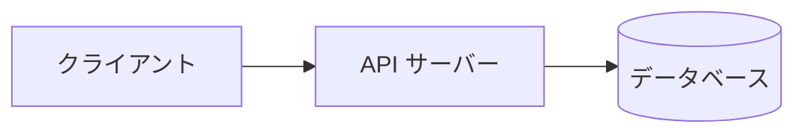
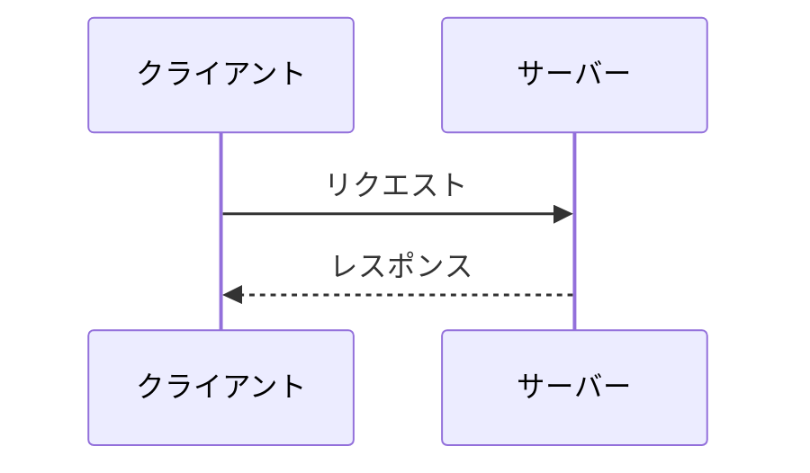

# 【設計書】機能名

| 項目 | 内容 |
| :--- | :--- |
| 文書番号 | DD-XXX |
| バージョン | 1.0 |
| 作成者 | 氏名 |
| 作成日 | YYYY-MM-DD |
| レビュー者 | 氏名 |
| ステータス | 作成中 / レビュー中 / 承認済 |

## 改訂履歴

| 版 | 日付 | 変更内容 | 担当 |
| :--- | :--- | :--- | :--- |
| 1.0 | YYYY-MM-DD | 初版作成 | 氏名 |

## 1. 目的・背景

<!-- この機能が必要な理由、解決する課題 -->

## 2. スコープ

### 対象

- 対象 1

### 対象外

- 対象外 1

## 3. 要件

| ID | 要件 | 優先度 |
| :--- | :--- | :---: |
| REQ-01 | 〇〇できること | 高 |
| REQ-02 | △△できること | 中 |

## 4. 全体構成

## 5. 処理詳細

### 5.1 処理フロー

### 5.2 入出力

| 項目名 | 型 | 必須 | 説明 |
| :--- | :--- | :---: | :--- |
| id | String | ○ | ID |
| name | String | ○ | 名称 |

## 6. エラー処理

| エラーコード | 条件 | 処理 |
| :--- | :--- | :--- |
| E001 | 必須項目未入力 | 400 を返却 |

## 7. 非機能要件

- 性能：
- セキュリティ：
- 可用性：

## 8. 懸念事項・未決事項

- [ ] 未決事項 1

## 9. 参考資料

- [資料名](URL)
