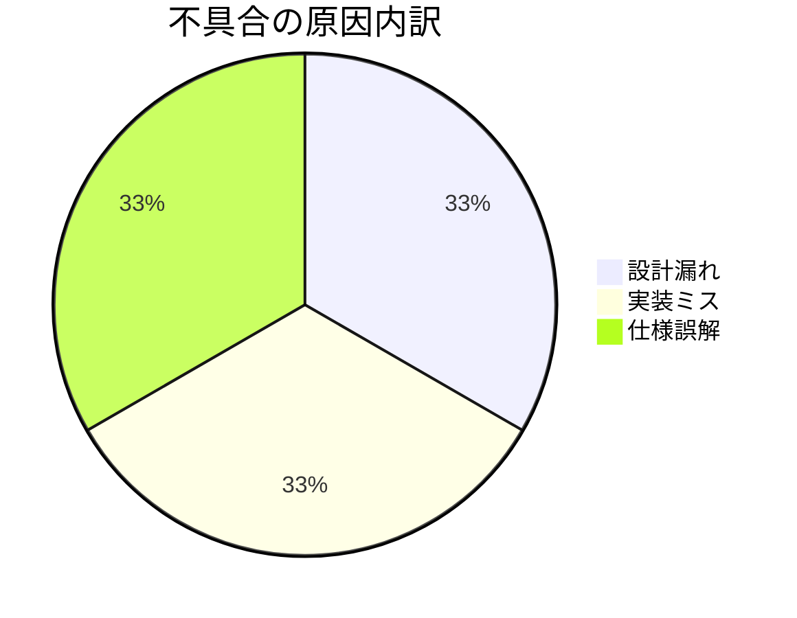

# テスト結果報告書：工程名（例：結合テスト）

| 項目 | 内容 |
| :--- | :--- |
| 対象システム | システム名 |
| 対象期間 | YYYY-MM-DD 〜 YYYY-MM-DD |
| 作成者 | 氏名 |
| 作成日 | YYYY-MM-DD |

## 1. サマリー

> [!IMPORTANT]
> **判定：合格 / 条件付き合格 / 不合格**
>
> 判定理由を 1〜2 文で記載する。

## 2. 実施状況

| 機能 | 計画件数 | 実施件数 | OK | NG | 消化率 |
| :--- | ---: | ---: | ---: | ---: | ---: |
| 機能 A | 0 | 0 | 0 | 0 | 0.0% |
| 機能 B | 0 | 0 | 0 | 0 | 0.0% |
| **合計** | **0** | **0** | **0** | **0** | **0.0%** |

## 3. 品質指標

| 指標 | 実績値 | 目標値（下限〜上限） | 評価 |
| :--- | ---: | :---: | :---: |
| テスト密度（件/KLOC） | 0.0 | 0.0 〜 0.0 | - |
| バグ密度（件/KLOC） | 0.0 | 0.0 〜 0.0 | - |
| 不良検出率（件/100 ケース） | 0.0 | 0.0 〜 0.0 | - |

$$
\text{テスト密度} = \frac{\text{テストケース数}}{\text{開発規模(KLOC)}}
\qquad
\text{バグ密度} = \frac{\text{不具合件数}}{\text{開発規模(KLOC)}}
$$

## 4. 不具合分析

### 4.1 重要度別

| 重要度 | 件数 | 対応済 | 未対応 |
| :--- | ---: | ---: | ---: |
| 高 | 0 | 0 | 0 |
| 中 | 0 | 0 | 0 |
| 低 | 0 | 0 | 0 |

### 4.2 原因別

## 5. 残課題

| No | 内容 | 対応方針 | 期限 |
| :---: | :--- | :--- | :--- |
| 1 | | | |

## 6. 所見

<!-- 品質に対する評価、次工程へのリスクと申し送り事項 -->
